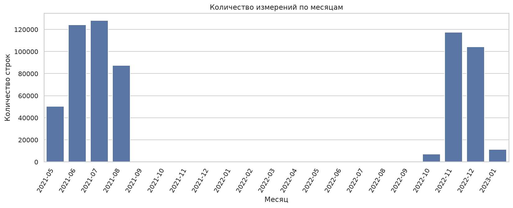
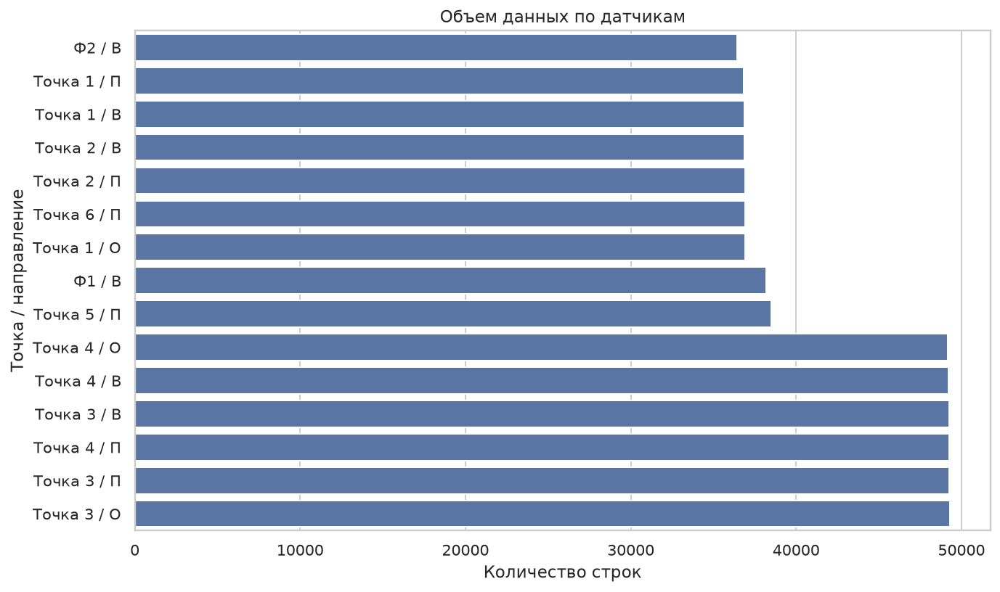
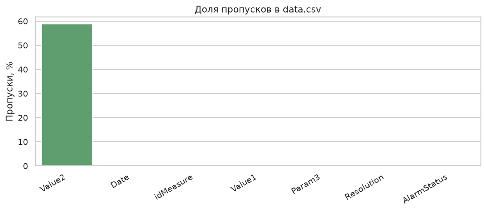
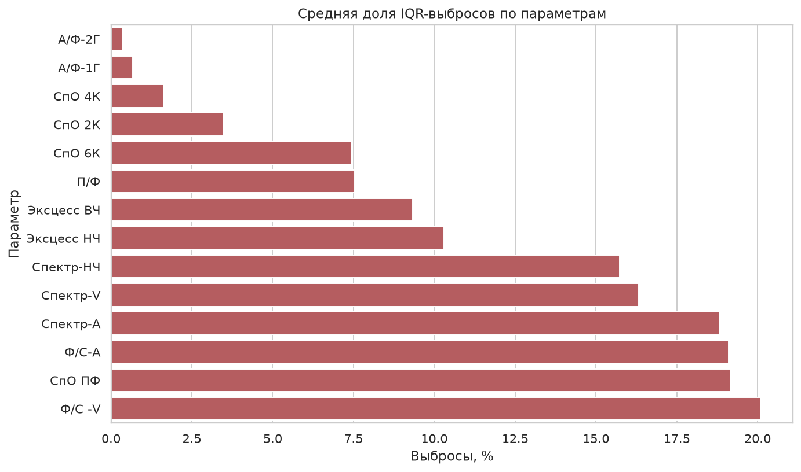
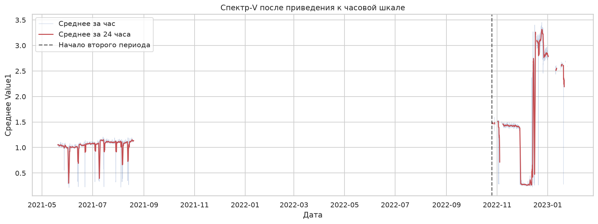
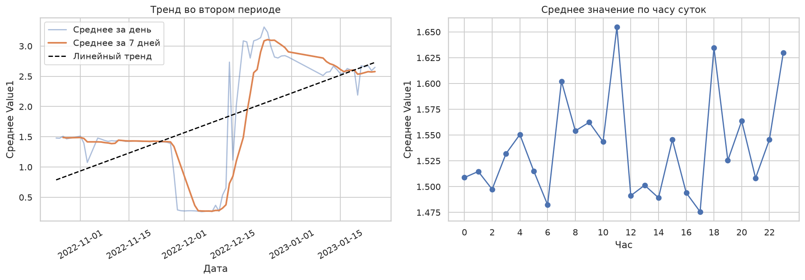
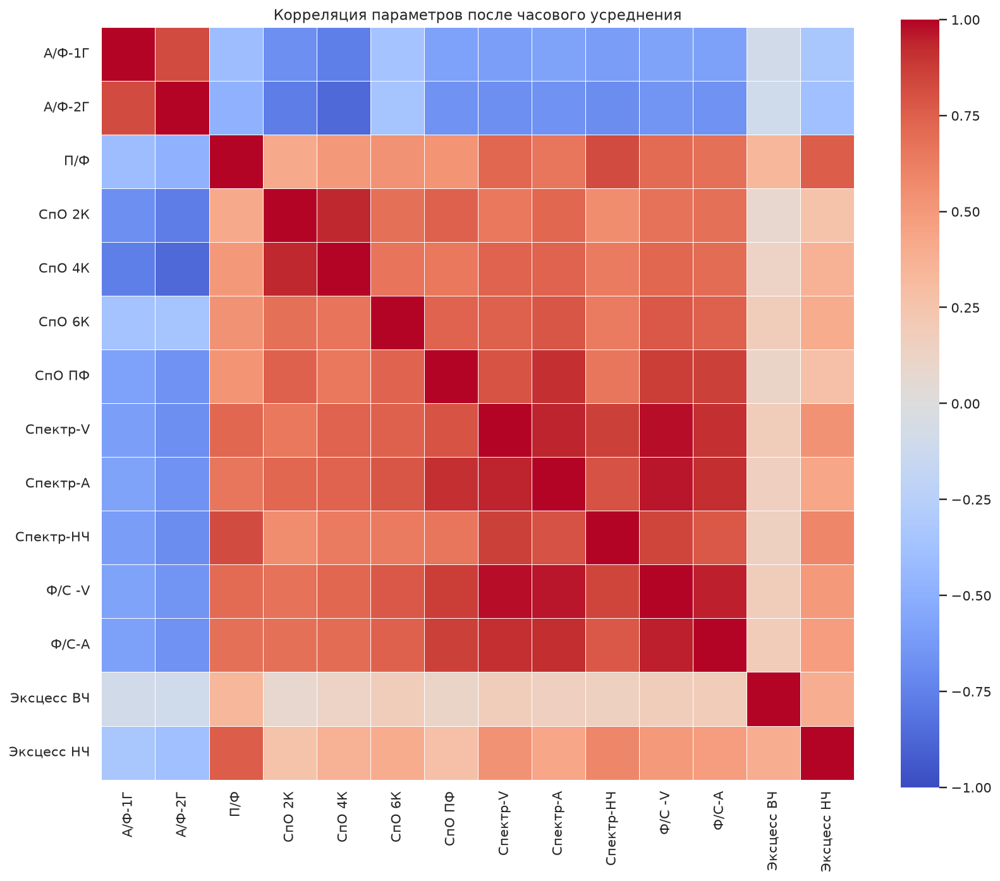

# Разведочный анализ данных измерений оборудования

Для анализа использовались таблицы `data.csv` с измерениями и `info.csv` с описанием каналов. Код находится в `eda.py`.

## 1. За какой период и с какой детализацией доступны данные?

В таблице находится **629 917 строк** от **183 измерительных каналов**. Измерения доступны с **20 мая 2021 года** по **25 января 2023 года**. Фактически данные есть за 169 дней.

Медианный интервал между соседними измерениями одного канала равен **57,2 минуты**, то есть измерения проводились примерно раз в час. При этом в данных есть большой разрыв около **433 дней** — между августом 2021 года и октябрем 2022 года.

Поэтому для дальнейшего анализа выбрана детализация **один час**.



## 2. Есть ли разница в объеме данных с разных датчиков?

Да, разница есть. На один `idMeasure` приходится от **2713 до 3752 записей**. Критически пустых каналов нет. Разница частично связана с тем, что для разных точек доступно разное количество видов измерений.

На диаграмме датчик обозначен как сочетание точки и направления измерения.



## 3. Какое качество данных: пропуски, адекватность значений, аномалии и выбросы?

- Дубликатов по сочетанию `idMeasure` и даты нет.
- В основном поле `Value1` пропусков нет.
- В `Value2` пропущено **369 876 значений**, но это поле используется только для части типов измерений, поэтому такие пропуски допустимы.
- Все значения `AlarmStatus` входят в допустимый список.
- Для каждого измерения найдено описание из `info.csv`.
- Постоянных каналов нет, все значения являются конечными числами.



Выбросы определялись простым правилом межквартильного размаха: выбросом считается значение ниже `Q1 - 1.5 * IQR` или выше `Q3 + 1.5 * IQR`.



Выбросы не удалялись, потому что они могут отражать реальное изменение режима работы оборудования. Канал считался качественным, если в `Value1` не больше 5% пропусков, нет дубликатов, значения не постоянны, все числа конечны, а объем данных составляет не меньше 75% медианного объема. Проверку прошли **все 183 канала**.

## 4. Как данные приведены к единой временной шкале?

Так как исходный интервал близок к часу, время округлялось до начала часа. Если внутри одного часа было несколько измерений одного канала, использовалось их среднее.

Пропущенные часы оставлены пустыми. Интерполяция не применялась, чтобы не создавать искусственные данные и сохранить большой разрыв между двумя периодами наблюдений.

Для иллюстрации использован параметр `Спектр-V`, усредненный по качественным каналам.



## 5. Есть ли в данных сезонность и тренд?

Анализ выполнялся для `Спектр-V` на втором периоде, начиная с **25 октября 2022 года**, чтобы разрыв больше года не влиял на результат.

Линейный тренд положительный: среднее значение увеличивается примерно на **0,021 в день**. Однако на графике видны резкие изменения режима в декабре, поэтому линейная модель описывает ряд только приблизительно.

Среднее значение зависит от часа суток: максимум наблюдается около **11:00**, минимум — около **17:00**. Это может говорить о внутрисуточной сезонности, но для строгого подтверждения нужен более длинный непрерывный период наблюдений.



## 6. Корреляционный анализ параметров

Перед расчетом корреляции одинаковые параметры были усреднены по датчикам внутри каждого часа. Самые сильные положительные корреляции:

1. `Спектр-V` и `Ф/С -V`: **0,983**;
2. `Спектр-А` и `Ф/С -V`: **0,969**;
3. `Ф/С -V` и `Ф/С-А`: **0,950**;
4. `Спектр-V` и `Спектр-А`: **0,943**;
5. `СпО 2К` и `СпО 4К`: **0,936**.



Многие вибрационные параметры изменяются похожим образом. При этом высокая корреляция не доказывает причинную связь, а сравниваемые параметры могут иметь разные единицы и физический смысл.

## Запуск

```bash
uv sync
uv run python eda.py
```

После запуска графики сохраняются в папку `EDA/results/`.
